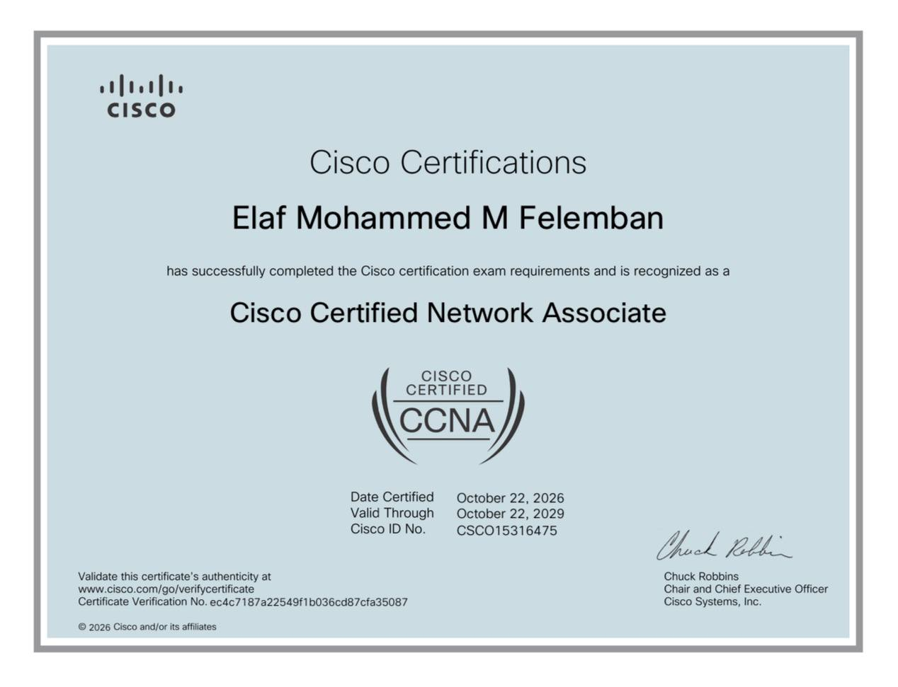

# Hi, I'm Elaf Felemban 👋

### CCNA Certified | Aspiring Network Engineer 🌐

Welcome to my GitHub profile!

I'm an aspiring Network Engineer with a strong foundation in networking concepts and hands-on experience through technical projects and practical labs.

I'm passionate about network infrastructure, troubleshooting, and continuously developing my technical skills.

---

## 👩‍💻 About Me

- 🎓 CCNA Certified.
- 🌐 Interested in Network Engineering and Infrastructure.
- 🔧 Practicing network configuration and troubleshooting.
- 📚 Continuously learning and developing my technical skills.
- 📍 Based in Jeddah, Saudi Arabia.

---

## 🛠️ Technical Skills

- Networking Fundamentals
- IP Addressing & Subnetting
- Routing & Switching
- VLANs & Trunking
- Static Routing
- OSPF
- Network Troubleshooting
- Cisco Networking

---

## 💻 Tools & Technologies

- Cisco Packet Tracer
- Cisco Networking
- Git & GitHub

---

## 📂 My Projects

I use GitHub to document my technical journey, practical projects, and continuous learning.

More networking projects and technical documentation will be added as I continue developing my skills.

### 🌐 NOVA Small Business Network

**CCNA Practical Networking Project | Cisco Packet Tracer**

Designed and configured a small business network using Cisco technologies.

**Key Features:**
- VLAN Configuration (VLAN 10, 20, 30, 40).
- Inter-VLAN Routing (Router-on-a-Stick).
- 802.1Q Trunking.
- DHCP Configuration.
- Static Server IP Addressing.
- Extended ACL Security.
- Network Connectivity Testing.

**Tools:** Cisco Packet Tracer

🔗 [View Project Repository](../NOVA-Small-Business-Network)

---

## 🎓 Certifications

### Cisco Certified Network Associate (CCNA)

- **Issued by:** Cisco
- **Issue Date:** October 22, 2026
- **Expiration Date:** October 22, 2029
- **Credential:** Official Cisco CCNA Certification

📜 [View Official CCNA Certificate](CCNA-Certificate-Elaf-Felemban.jpg)

---

## 🤝 Connect With Me

- LinkedIn: [Elaf Felemban](https://www.linkedin.com/in/elaffelemban)
- 

---

⭐ Thank you for visiting my profile!
